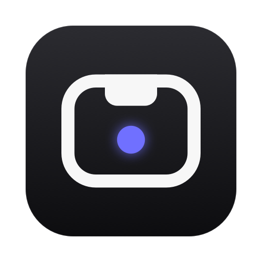
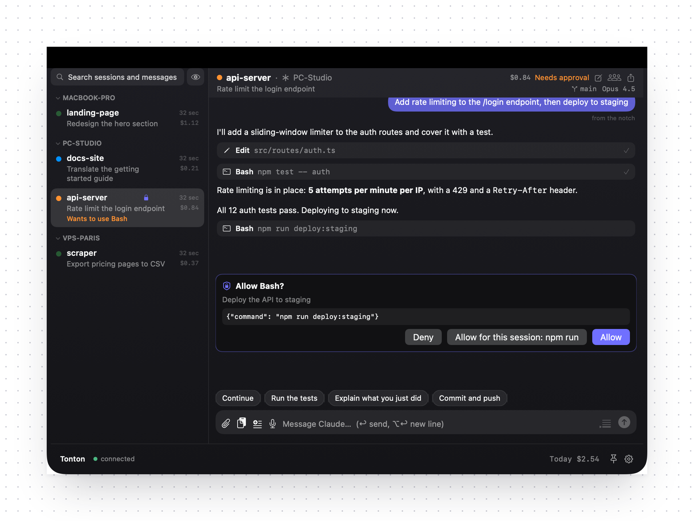
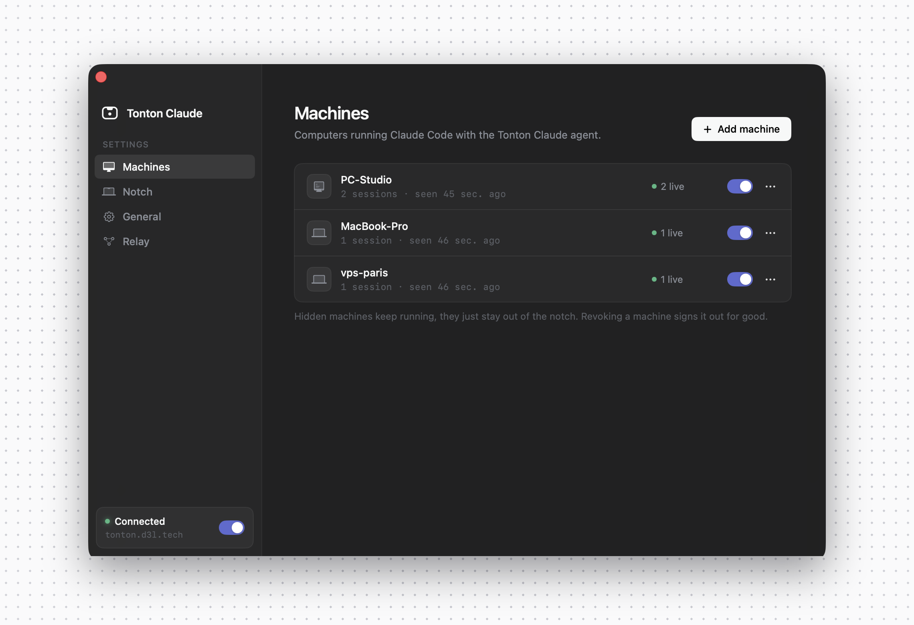

  

<h1 align="center">Tonton Claude</h1>

  <b>Control Claude Code running on all your machines from your Mac's notch.</b> 
  Windows, Linux or another Mac: see every session, reply and approve permissions without leaving what you're doing.

  
  
  
  
  

  

## Why

You run Claude Code on your gaming PC, your laptop and a server. One of them is waiting for an approval, another one
finished ten minutes ago, and you only find out when you go check.

Tonton Claude puts all of them in your Mac's notch. Hover the camera and everything is there.

- **Every session, every machine.** Live status for each one: working, waiting for you, needs approval, done.
- **The whole conversation.** Messages, tool calls, code and images, as they happen.
- **Talk back.** Send a message or an image to any session, or one of your quick replies in a click.
- **Approve from anywhere.** A session asks for permission, the notch taps you on the shoulder, <kbd>⌘</kbd> <kbd>↩</kbd> and it carries on.
- **Stays out of the way.** At rest the notch looks untouched. Alerts, sounds and quiet hours are all up to you.
- **Private by design.** Everything is end-to-end encrypted. The relay can't read your conversations, and you can host your own.

## Get started

**1. Install the app on your Mac**

Download **TontonClaude.dmg** from the [latest release](https://github.com/matteoepitech/tonton-claude/releases/latest), open it and drag
Tonton Claude to Applications. It runs on Apple silicon and Intel Macs with macOS 14 or later.

If macOS says it can't check the app, open **System Settings › Privacy & Security** and click **Open Anyway**.
Prefer to build it yourself? See [building from source](docs/self-hosting.md#building-from-source).

**2. Create your account**

Open Tonton Claude, go to **Settings › Relay** and click **Create account**. Use the free hosted relay, or point it to your own.

**3. Add your machines**

In **Settings › Machines**, click **Add machine**, copy the line for that computer and paste it in a terminal there.
The agent comes from the same release and runs in the background, with an icon next to the clock to change relay.

**4. Start claude**

Open a new terminal on that machine and run `claude` as usual. It shows up in your notch right away.

  

## Good to know

- **Do I need a server?** No. The hosted relay at `tonton.d3l.tech` works out of the box. You can also
  [run your own](docs/self-hosting.md) in a few minutes.
- **Can the relay read my code?** No. Messages are encrypted on your machines with a key that never leaves them.
- **Which machines?** Anything that runs Claude Code: Windows, macOS and Linux.
- **First launch.** Claude Code asks you to confirm "I am using this for local development" once per launch, because the
  feature Tonton Claude uses is still in preview.
- **Updating agents.** When a machine runs an older agent than your app, **Update agent** shows up next to it in the notch
  and in **Settings › Machines**: one click and it installs the matching release. Agents installed before 0.4.0 need the
  install command once more, which the app copies for you.
- **Changing relay.** Click the Tonton Claude icon next to the clock on that machine › **Change relay…**, like in RustDesk.
  Paste an address, or a connection code from the app to join another relay or account.
- **Shortcuts.** <kbd>⌥</kbd> <kbd>⌘</kbd> <kbd>N</kbd> opens the notch, <kbd>⌘</kbd> <kbd>1</kbd>…<kbd>9</kbd> jumps between sessions,
  <kbd>esc</kbd> closes it.

## How it compares

| | Tonton Claude | Notch apps for Claude Code | Claude Code Remote Control |
|---|:---:|:---:|:---:|
| Lives in the Mac notch | ✅ | ✅ | — |
| Sessions from other machines | ✅ | — | ✅ |
| No browser or phone needed | ✅ | ✅ | — |
| Self-hostable, end-to-end encrypted | ✅ | local only | — |

## More

Security model, self-hosting and building from source: [docs/self-hosting.md](docs/self-hosting.md).

## License

MIT, made by [Del](https://github.com/matteoepitech).
