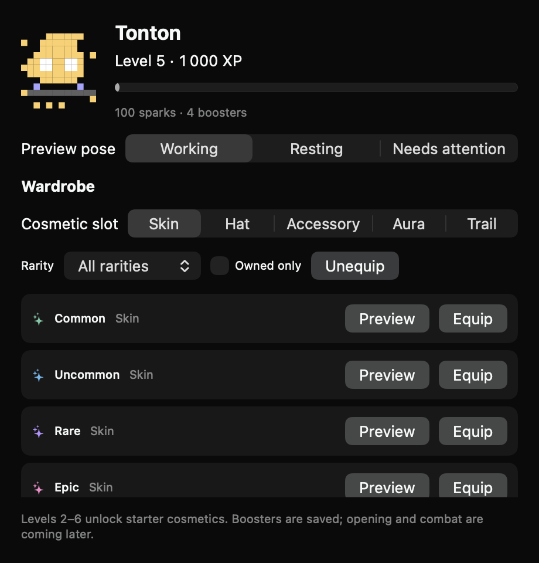
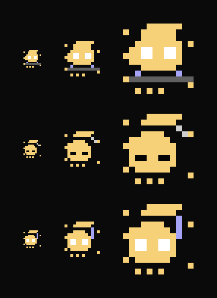

# Tonton's progression (rules version 1)

One account has one Tonton. Every machine contributes to it. A hackathon never resets the hero. Work rewards apply
equally to Claude Code and OpenCode. Cosmetics change appearance; combat upgrades change combat statistics.

## Rewards

| Source | XP | Sparks | Identity and limit |
| --- | ---: | ---: | --- |
| Completed checklist task | 10 | 1 | Session and normalized task text; once, even after reopening |
| Completed pool task | 50 | 5 | Pool and task id; once for the assignee at completion |
| Accepted review | 20 | 2 | Pool and task id; once for the reviewer at acceptance |
| Won combat encounter | 15 | 2 | Run and encounter id; once per encounter |
| Won boss fight | 75 | 10 | Run and boss id; once per boss |

These are tunable defaults, recorded with the rules version. Work rewards are capped at 1,000 XP per UTC day;
combat rewards at 300 XP. An award crossing the cap receives only the remaining XP and proportional sparks, rounded
down. Its receipt is still saved. Replaying it tomorrow earns nothing. Idle time, token spending, tool calls and
ordinary assistant messages earn nothing. Cancelled or failed tasks earn nothing. A completed checklist item is
self-reported work, not proof that tests pass. Pool tasks are the larger unit of work; a pool session's checklist
does not also earn solo XP.

Solo rewards begin with successful checklist results observed by the updated agent. Loading an old transcript or
OpenCode history does not backfill XP. Pending rewards already saved by the agent do survive restarts. Local-only
sessions shown by the Mac without an agent do not produce rewards. Pool completions store their original assignee,
reviewer and completion time in the sealed task, so a later reassignment cannot move an existing reward.

Level 1 starts at zero XP. Reaching level L needs 50 × L × (L − 1) lifetime XP: level 2 needs 100, level 3 needs 300,
level 4 needs 600. The maximum level is 100; XP can continue accumulating. Each new level grants one unopened
booster, identified by that level. The first completed task earns 10 XP and one spark. Ten such tasks reach level 2
and grant one booster. Six pool tasks earn 300 XP, level 3 and two boosters. A fight and a boss earn 90 XP and 12
sparks before the daily combat cap. Sparks buy permanent upgrades: the next rank costs 10 × (current rank + 1),
up to ten ranks each in health, attack and movement. The combat implementation owns the resulting stat multipliers.

## Cosmetics and boosters

Slots are skin, hat, accessory, aura and trail. One owned item per slot may be equipped; an absent or unknown asset
renders the base character without deleting ownership. All poses use the same anchors. Rarity is also shown as text.
The starter catalog has one item of each rarity in each slot. A free base skin is always available. To make progress
visible before booster opening ships, levels 2–6 also unlock one starter item per slot, once each.

Earned boosters contain one cosmetic. Version 1 odds are common 60%, uncommon 25%, rare 10%, epic 4%, legendary 1%.
Choose uniformly among items of the selected rarity. A duplicate becomes 1, 3, 8, 20 or 50 sparks respectively. No
purchase flow, paid currency or pity counter exists in version 1. The opening implementation must commit the draw,
consumption and reward together before playing its animation. Cancelling an animation never rerolls an item.

## Persistence and trust

The relay stores one opaque encrypted document per account, with an increasing revision. Clients read, decrypt,
apply an operation, encrypt, and compare-and-swap the revision. Conflicts re-read and reapply the same operation.
Receipts, boosters, inventory, loadout and balances are in that same transaction. Receipts are retained independently
of bounded pool/session history; reaching the receipt cap stops new rewards rather than silently forgetting claims.
Unknown schema versions and undecryptable documents fail closed, never overwrite with an empty hero.

Pending agent awards are sealed on disk and retried after reconnect/restart. A timeout after commit is safe to retry.
Clients show only committed balances. A new device reads the same document; account changes use a separate cache.
The Mac refreshes the committed hero every three seconds and disables equipment changes while syncing. Equipment
changes require a connection and report failures rather than claiming an item was equipped offline.
Old relays return 404 and leave RPG unavailable while sessions continue working. Upgrading the relay enables RPG.
Account-key regeneration deletes the unreadable old hero along with revoking machines; pool key rotation does not
affect the private hero. Pool-shared scores and profiles must use the pool key, never publish the private inventory.

The relay checks authentication, size and revisions, not XP. An account owner with a modified client can forge their
own progression. This is a friendly game, not a server-verified economy. Pool competition must derive contribution
scores from pool work receipts, excluding combat and solo work; it must not expose those private activities.

## Delivery

Issues #269–#273 deliver rules, encrypted storage, work rewards, the catalog/wardrobe and notch progression.
Booster opening, combat and pool competition are separate follow-up issues linked from #267. Until delivered,
unopened boosters are retained and the character panel explains that opening and combat are coming later.

The storage layer already provides idempotent upgrade purchases (by target rank) and committed booster outcomes
(by booster id). Two devices submitting different candidate items for one booster see the first committed item.
Drop selection, granting combat boosters, the opening UI and combat stat application belong to the follow-up issues.

## Rollout

Update the relay first, then agents and the Mac app. The new REST routes are `GET`/`PUT /api/rpg` for accounts and
`GET`/`PUT /api/agent/rpg` for enrolled machines. A request has `{ rev, blob }`; a stale revision returns 409.
The document is capped at 4 MiB per account. The relay has no public progression endpoint.

| Relay | Agent | Mac app | Behavior |
| --- | --- | --- | --- |
| Old | New | New | Sessions work; the panel asks for a relay update; agent rewards remain pending. |
| New | Old | New | Existing hero is readable; old agents do not earn XP. |
| New | New | Old | Agents earn and save XP; old apps keep their existing UI. |

No pool key or account key is exposed to the relay. Private hero data is independent of pool keys. A future pool
leaderboard must publish a separate pool-key-encrypted profile, not forward the account document.

## Visual checks

The wardrobe was rendered from its SwiftUI view at 380, 460 and 500 points, using sample ownership and the dark
palette. Native controls were captured in an offscreen NSHostingView because ImageRenderer does not render them.
The sprites were checked at 18, 36 and 72 points in each existing pose with motion disabled in the renderer.
These images do not verify live animation timing, hover, scrolling or the actual notch window.

