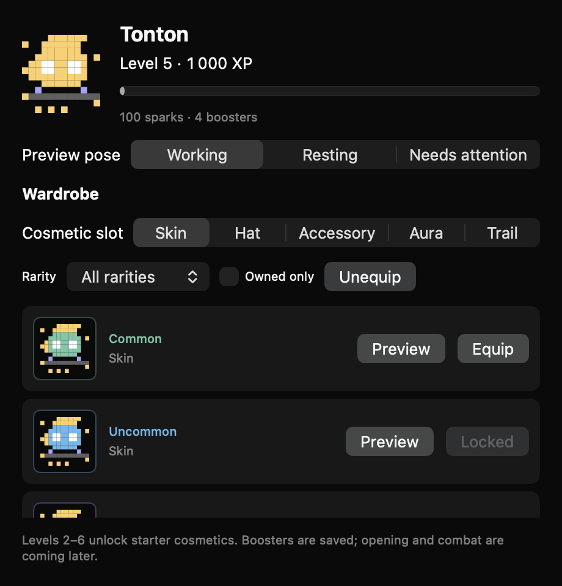
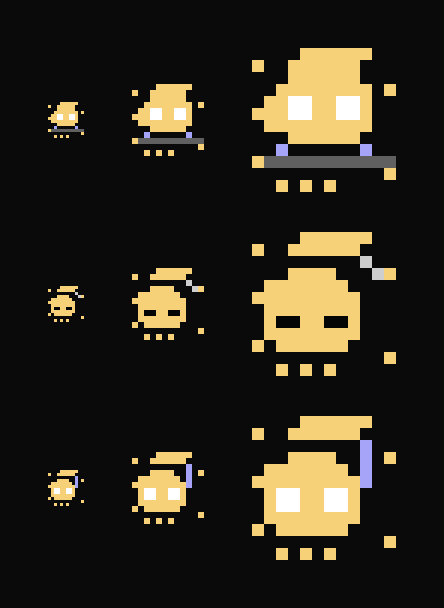
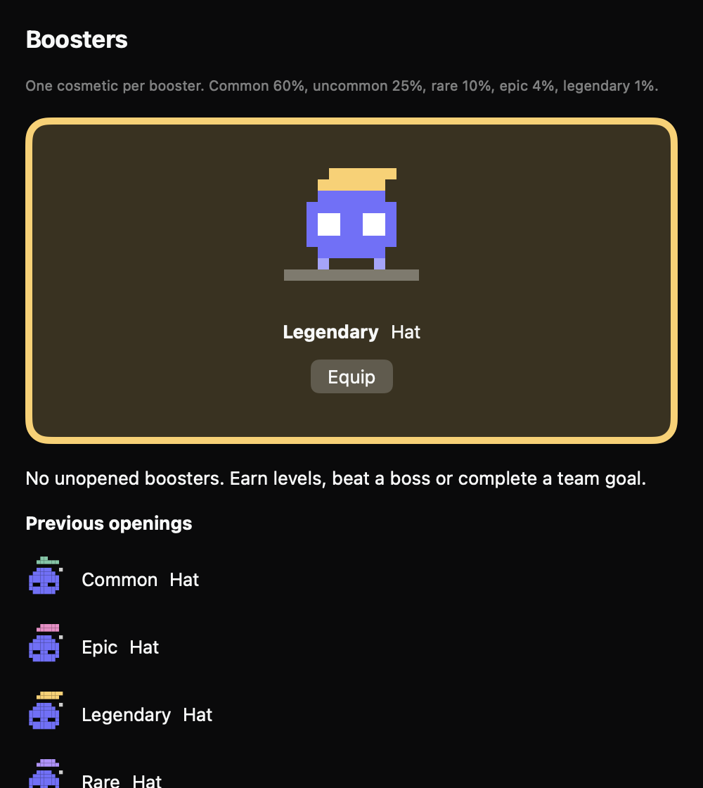
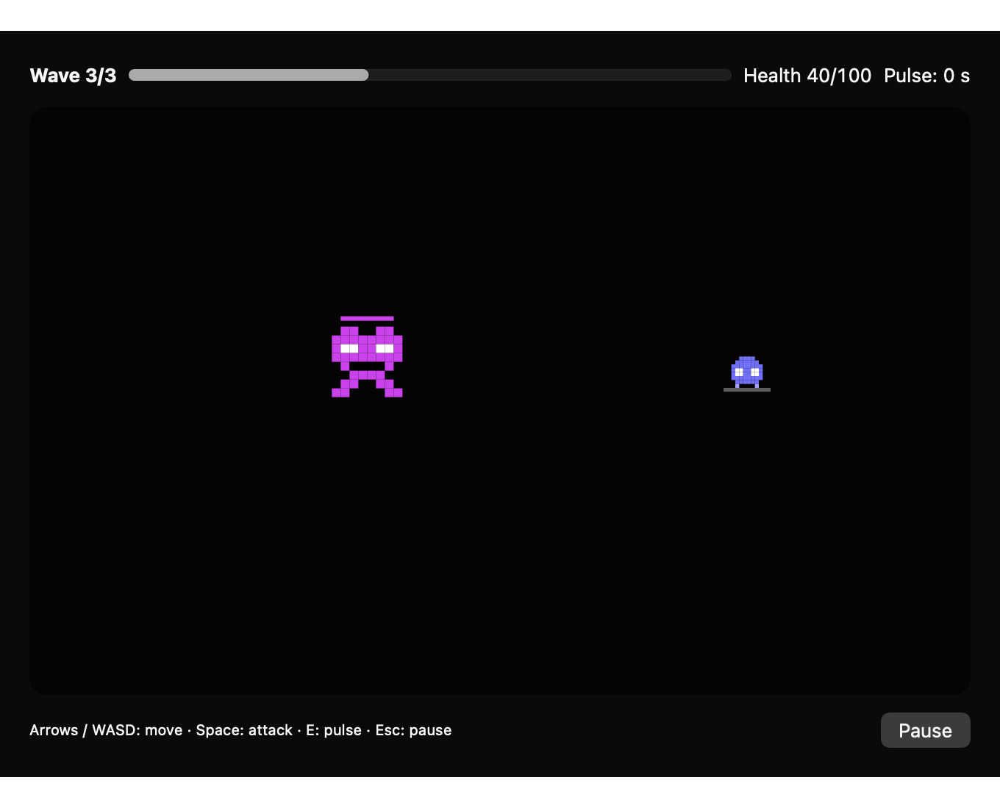
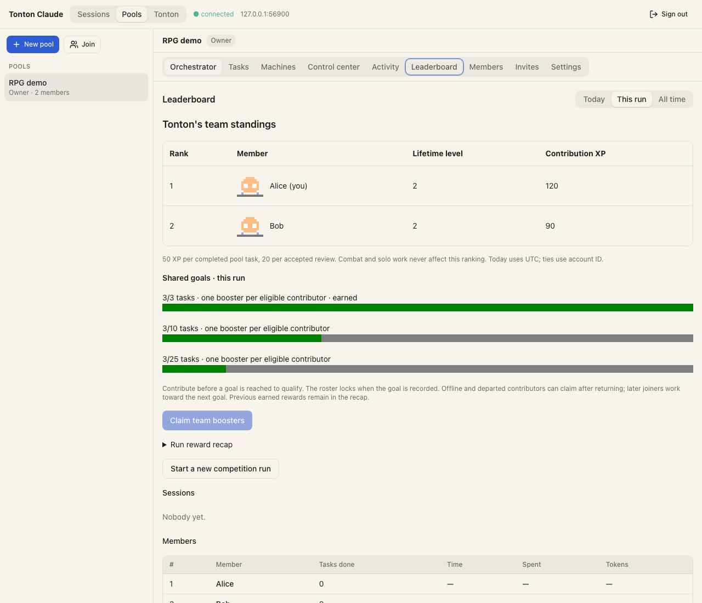
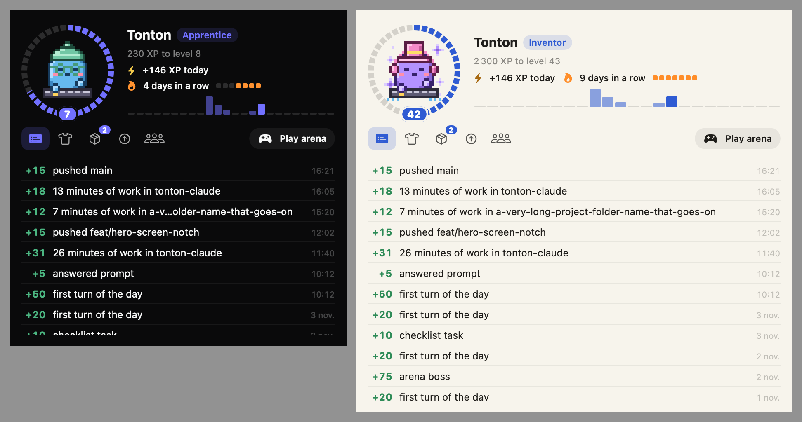
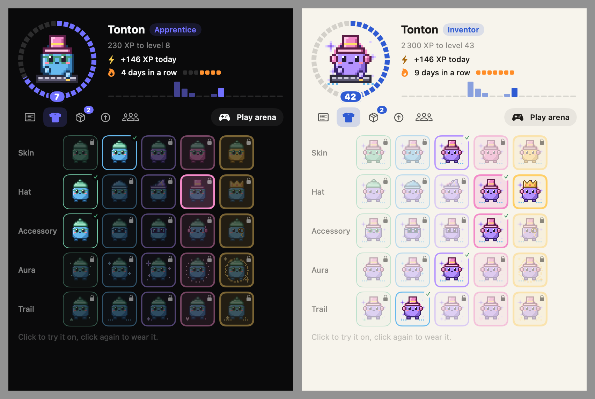
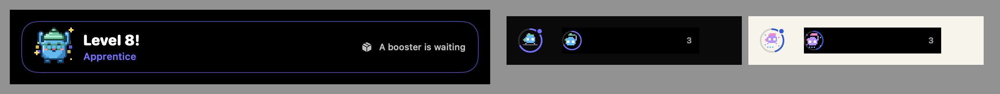
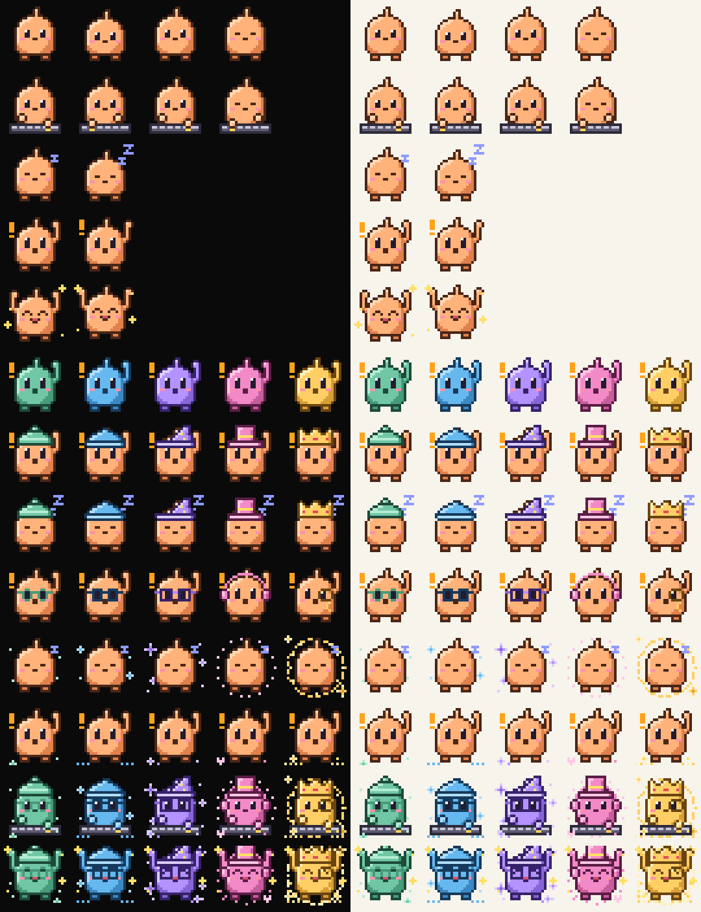
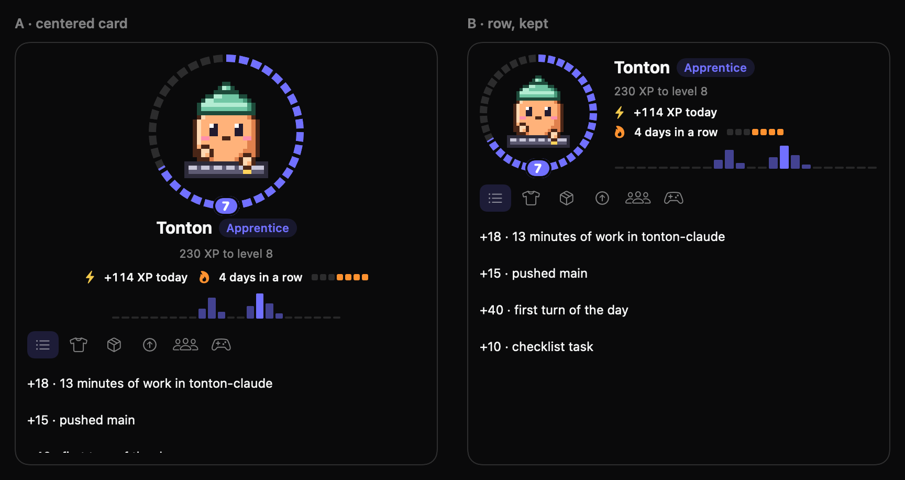

# Tonton's progression (rules version 2)

One account has one Tonton. Every machine contributes to it. A hackathon never resets the hero. Work rewards apply
equally to Claude Code and OpenCode. Cosmetics change appearance; combat upgrades change combat statistics.

## Rewards

Rules version 2 rewards the work Claude Code and OpenCode actually do: answered prompts, minutes of work, finished
tasks and pushes. Version 1 rewarded only checklist items and pool tasks, and Claude Code rarely writes a checklist.

| Source | XP | Sparks | Identity and limit |
| --- | ---: | ---: | --- |
| Answered prompt: a turn its user typed (terminal, notch or website) that ends without failure | 5 | — | Session and turn; 1 XP if the turn worked less than 5 seconds |
| Work time | 1 per minute the turn worked | — | Every 10 minutes of a turn still going, a receipt of its own (+10); the rest on the turn's receipt, 60 minutes at most there. Waits on a permission prompt excluded where the agent can tell |
| First prompted turn of the UTC day | 20, plus 10 per day of streak | — | Account and UTC day; 50 at most, once a day for the whole account |
| Commit pushed, or Perforce changelist submitted | 15 | — | Commit hash, or server and changelist; once each, whichever remote |
| Completed checklist task (`TodoWrite`, `TaskUpdate` to completed, OpenCode's `todowrite`) | 10 | 1 | Session and normalized task text; once, even after reopening |
| Completed pool task | 50 | 5 | Pool and task id; once for the assignee at completion |
| Accepted review | 20 | 2 | Pool and task id; once for the reviewer at acceptance |
| Won combat encounter | 15 | 2 | Run and encounter id; once per encounter |
| Won boss fight | 75 | 10 | Run and boss id; once per boss |

A short turn earns one receipt: its prompt and its minutes together, so "13 minutes of work" reads as +18 XP (5 + 13).
A long one earns as it goes: each 10 minutes of work is a `turn` receipt of its own, named by the turn's first line
and its rank, and shows up in the journal while Claude still works ("10 minutes of work", +10). When the turn ends,
its receipt has the prompt and the minutes the slices left, so a turn of three hours earns its three hours
(`agent/src/rpg-slices.ts`). A silence of more than 15 minutes between two lines of a turn counts 15: a crash or a
sleeping Mac is no work.
The streak counts the days in a row before this one that had a first turn: 20 XP on the first day, 30 on the second,
40 on the third, 50 from the fourth. Work rewards (everything above but combat) earn one spark per 10 XP, rounded
down per award; a full prompt alone earns none. These are tunable defaults, one set of constants: `RPG_RULES` in
`shared/rpg.ts` and `RPG.Rules` in `TontonCore/RPG.swift`, checked against each other by
`shared/test/rpg-v2-vectors.json`.

Work rewards are capped at 1,500 XP per UTC day (1,000 in version 1); combat rewards at 300 XP. An award crossing the
cap receives only the remaining XP and proportional sparks, rounded down. A turn started by a pool or cluster post
earns its minutes but not the prompt, and never the day's first turn, so two Claudes cannot farm each other.
Subagents work inside their parent's turn and count once, with it. Idle time, token spending, tool calls and ordinary
assistant messages earn nothing. Cancelled, interrupted or failed turns earn their minutes, not the prompt. Cancelled
or failed tasks earn nothing. A completed checklist item is self-reported work, not proof that tests pass. Pool tasks
are the larger unit of work; a pool session's checklist does not also earn solo XP.

The agent sends facts, never amounts: a turn's length, whether its user typed it, a commit's identity. The rules
above turn them into XP when the reward is applied, so every client computes the same hero. Pending rewards already
saved by the agent survive restarts. They are applied oldest first, so each day's streak and cap see the days before
it. Pool completions store their original assignee, reviewer and completion time in the sealed task, so a later
reassignment cannot move an existing reward.

Level 1 starts at zero XP. Reaching level L needs 50 × L × (L − 1) lifetime XP: level 2 needs 100, level 3 needs 300,
level 4 needs 600. The curve is the same as in version 1, so no hero loses a level. The maximum level is 100; XP can
continue accumulating. Each new level grants one unopened booster, identified by that level.

A worked example. A day of 60 prompts, 4 hours of work and 5 pushed commits earns 60 × 5 + 240 + 5 × 15 + 20 = 635 XP.
One hour of it (15 prompts, 60 minutes, the first turn) is 155 XP: level 2. Two such days are 635 + 645 = 1,280 XP:
level 5 (1,000). A week, with the streak at its maximum from the fourth day, is about 4,600 XP: level 10 (4,500).
In version 1 terms, the first completed task still earns 10 XP and one spark, and six pool tasks earn 300 XP,
level 3 and two boosters. A fight and a boss earn 90 XP and 12 sparks before the daily combat cap. Sparks buy permanent
upgrades: the next rank costs 10 × (current rank + 1), up to ten ranks each in health, attack and movement. The combat
implementation owns the resulting stat multipliers.

### How the agent finds the work

The agent reads Claude Code's transcripts and OpenCode's events as they come. A Claude Code turn is named by the
`turn_duration` line that ends it. The `origin` of the line that starts it says who did: `human` and the notch are its
user, while task notifications, scheduled wakeups and other sessions' messages are not. An OpenCode 1 turn is a user message and
the answers that name it as their parent, from the prompt to the last answer. An OpenCode 2 turn runs from busy to
idle and is named by its prompt. A pool post is its `<pool kind=…>` envelope in both tools. Time waiting on a
permission prompt comes off the turn when the agent sees the answer: OpenCode's prompts, and Claude Code's answered
from the notch, the website or the phone. A Claude Code prompt answered in its own terminal can't be timed.
`TodoWrite`, OpenCode's `todowrite` and `TaskUpdate` to completed are tasks. `TaskUpdate` uses the subject it gives,
or the one `TaskCreate` gave that task. Pushes and submits come from what a shell call printed
(`agent/src/cluster/detect.ts`). A push counts the session's own commits on that branch since its last push, else
the head the push names. Each commit counts once by its hash, so pushing it again or to another remote earns nothing
more. Tags, review refs, rejected pushes and a new branch with no known commit earn nothing. A submit is named by its
change and the server its command gives with `-p` or `P4PORT=`. The agent runs neither git nor p4. Pool sessions earn
their turns and pushes: minutes only for a turn a pool post started, and never their checklist.

Only new work earns live. When the agent starts following a session (a new channel, `claude --resume`, the OpenCode
bridge meeting a session halfway), what it reads first only tells it where the session is. The welcome backfill pays
the past once. A minute after the background service starts with an updated agent, it reads this machine's last 14
days, once per relay and account. That covers every Claude Code transcript, including sessions started without
Tonton's channel, and OpenCode 1's database, read-only. It uses the same code as the live agent, so every reward has
the identity the live agent would give it and nothing counts twice. A marker and a lock in the agent's `rpg` folder
keep it to one run. It runs again at the next start if a reward could not be kept. Subagents' transcripts and
sessions are left out, as live: their work is inside their parent's turn. OpenCode 2 history is not backfilled, and a
machine with `TONTON_SERVICE=off` gets no backfill. Local-only sessions shown by the Mac without an agent never earn
live.

### Receipts and gains

Version 1 kinds (tasks, pool tasks, reviews, combat) keep their receipts in `receipts`, never pruned. Version 2 kinds
(`turn`, `day`, `push`) keep theirs in `gains`, a field apps of version 1 do not read. A gain carries its UTC time,
a turn its seconds, and both may carry a short sealed note for the journal (the project folder, the branch), at most 80
characters. The hero screens read them through `rpgToday` and `rpgJournal` (`shared/rpg-journal.ts`,
`TontonCore/RPGJournal.swift`): today's XP, the streak, XP per UTC hour, and the last gains.

Gains are many, so they are bounded. A gain whose UTC day is more than 21 days before the award, or more than a day
after it, earns nothing. Gains older than 30 days are pruned when a new one is applied: the 9 days between the two
mean a pruned receipt can never be earned again. At most 200 gains a UTC day are kept; more earn nothing. A gain that
earns nothing (the cap is reached, or a turn a post started worked less than a minute) leaves no receipt: its day's
total can only grow, so replaying it can never earn more. Version 1 receipts keep their rule: a capped receipt is
saved, and reaching 10,000 stops new rewards rather than forgetting claims.

## Cosmetics and boosters

Slots are skin, hat, accessory, aura and trail. One owned item per slot may be equipped; an absent or unknown asset
renders the base character without deleting ownership. All poses use the same anchors. Rarity is also shown as text.
The starter catalog has one item of each rarity in each slot. A free base skin is always available. To make progress
visible before booster opening ships, levels 2–6 also unlock one starter item per slot, once each.

Earned boosters contain one cosmetic. Version 1 odds are common 60%, uncommon 25%, rare 10%, epic 4%, legendary 1%.
Choose uniformly among items of the selected rarity. A duplicate becomes 1, 3, 8, 20 or 50 sparks respectively. No
purchase flow, paid currency or pity counter exists in version 1. The opening implementation must commit the draw,
consumption and reward together before playing its animation. Cancelling an animation never rerolls an item.

## The hero screen in the notch

The notch's bottom bar shows Tonton in a thin ring that fills with the XP of his level; a dot on it means a booster
waits to be opened, and the closed notch draws the same ring around the mascot beside the camera. A click on the ring
opens the hero screen in the right column, in place of the conversation; picking a session goes back to it. The card
on top shows Tonton large in a segmented level ring, the level, a title every ten levels (Apprentice, Builder,
Architect, Pathfinder, Inventor, Artisan, Sage, Wizard, Luminary, Legend), the XP to the next level, today's XP, the
streak with its last seven days and a bar per hour of the UTC day, labelled in local time. His pose follows the live
sessions: working, resting or needing the user. Under the card, icons switch between the journal of the last gains
("+18 · 13 minutes of work in tonton-claude"), the wardrobe, boosters, upgrades with the achievements, and the team; the
arena opens in its own window. The wardrobe is a grid of every cosmetic, one row per slot and one column per rarity,
each tile framed in its rarity's colour and weight: the first click tries it on the big Tonton, the second wears it,
or takes it off when he already wears it.

When a turn's XP arrives, "+XP" floats from that session's row into the ring; a new level shows for a moment across
the notch with Tonton cheering, then its booster waits on the ring. Like the other celebrations, neither plays during
quiet hours, without the mascot, or while a session needs the user; Reduce Motion writes the XP beside the ring and
keeps the level-up still. VoiceOver announces the new level.

The 24 × 24 art is `shared/rpg-art.json`: five poses (idle, working, resting, attention, cheer), each a few frames with
the anchors cosmetics hang on, then a mask per slot and rarity, and the colours. `.` is empty, `O` `1` `2` `3` are the
outline and three shades of the skin's ramp (or the item's), any other character a fixed colour. A layer's origin pixel
lands on its anchor in the current frame, so a hat follows the breath; layers draw in `order`, back to front, and an
unknown character or a pixel off the square is skipped. The website draws it with `web/hero.ts`; the app with
`HeroArt` in TontonCore, from a byte-identical copy that `HeroArtTests` compares with the file.
`shared/test/rpg-art-vectors.json` holds the hash of a few composed sprites, checked on both sides. Under 32 points
the 12 × 12 mascot draws Tonton instead.

## Persistence and trust

The relay stores one opaque encrypted document per account, with an increasing revision. Clients read, decrypt,
apply an operation, encrypt, and compare-and-swap the revision. Conflicts re-read and reapply the same operation.
Receipts, boosters, inventory, loadout and balances are in that same transaction. Receipts are retained independently
of bounded pool/session history; reaching the receipt cap stops new rewards rather than silently forgetting claims.
Unknown schema versions and undecryptable documents fail closed, never overwrite with an empty hero.

Pending agent awards are sealed on disk and retried after reconnect/restart. A timeout after commit is safe to retry.
Clients show only committed balances. A new device reads the same document; account changes use a separate cache.
The Mac refreshes the committed hero every three seconds and disables equipment changes while syncing. Equipment
changes require a connection and report failures rather than claiming an item was equipped offline.
Old relays return 404 and leave RPG unavailable while sessions continue working. Upgrading the relay enables RPG.
Account-key regeneration deletes the unreadable old hero along with revoking machines; pool key rotation does not
affect the private hero. Pool-shared scores and profiles must use the pool key, never publish the private inventory.

The relay checks authentication, size and revisions, not XP. An account owner with a modified client can forge their
own progression. This is a friendly game, not a server-verified economy. Pool competition must derive contribution
scores from pool work receipts, excluding combat and solo work; it must not expose those private activities.

## Play, open and upgrade

On Mac, click the ring around Tonton in the notch's bottom bar: the hero screen opens in the right column, with
**Journal**, **Wardrobe**, **Boosters**, **Upgrades** and **Team** behind its icons. The website has a **Tonton** tab for the
same inventory, openings and upgrades, and pool leaderboards show contribution XP and shared goals. Its hero card shows
the level ring, today's XP with the streak and a bar per hour; the journal of the last gains is the first page under it,
and the wardrobe tries an item on the big Tonton at the first click and wears it at the second. On Windows and Linux, the island's closed bar
shows the level ring and the last gain; a click on the ring opens the same hero page in the island. Both draw the
24 × 24 art of `shared/rpg-art.json`, the notch's too, through `web/hero.ts`.

Loot table 1 uses the probabilities above and uniformly selects a slot within the chosen rarity. Browser draws use
WebCrypto; Mac draws use the system random generator. The two random values are selected before the transaction,
so CAS retries do not draw again. An opening receipt records the item, duplicate sparks and `tableVersion: 1`.
An older receipt without that optional field means table 1. The booster id identifies its source: `level-N`,
`boss-v1-<receipt>`, `achievement-v1-<achievement>`, or `team-v1-<pool>-<run start>-<target>`.
Unknown items and invalid tables fail before consuming anything. Previous openings can always be reopened in the UI.
The animation starts only after commit; skipping, closing or losing a response cannot change that outcome.
Reveals use rarity text, color, border weight and a short particle burst on Mac. Reduce Motion reveals immediately.
Neither client plays audio, so sound, quiet hours and Focus settings are never bypassed by an opening.

Health starts at 100 and gains 15 per rank. Attack starts at 15 and gains 3. Movement starts at 120 arena units per
second and gains 6. Each has ten ranks at the costs above. Purchases use the target rank, so retrying rank 1 after a
lost response cannot buy rank 2. Stats are frozen when a run starts; new upgrades affect the next run. Cosmetics
never change stats.

The native Mac arena is 640 × 400 units. Arrows or WASD move, Space attacks the nearest enemy within 68 units,
E pulses all enemies within 130 units, and Escape pauses. The pulse has a five-second cooldown; the attack has a
0.4-second cooldown. Controls are local to the arena's window. It cannot send prompts, approve permissions, spend
agent budgets or stop a coding session. Tab navigation and ordinary buttons handle opening, claiming and purchases.

A run has three chasers, then four mixed chasers/chargers, then a boss. Chasers deal contact damage; chargers mark
where they will dash; the boss marks a larger impact area and attacks faster below half health. Shapes, outlines and
an exclamation mark preserve cues without color or sound. Clearing a wave heals 20, up to maximum health. Defeat
pays nothing and can be restarted. Victory pays two encounter receipts and one boss receipt: up to 105 XP and 14
sparks, subject to the daily combat cap. A boss with positive awarded XP also grants one booster; capped bosses
cannot mint boosters endlessly. The maximum is four rewarded bosses per UTC day, fewer after encounter XP.
A fresh run has a new UUID; replaying a saved result keeps its original UUID and UTC start date.

The simulation uses fixed 1/60-second steps and bounds catch-up to 0.25 seconds. Losing keyboard focus, minimizing
or closing pauses it and clears input. Paused play stops the simulation task and mascot timeline. An account-key-
encrypted local checkpoint is saved every second and at transitions. Restart restores it paused. Offline play may
finish one run; its won result is retained until a successful claim, before another run can start. A claim can be
retried on a lost response without duplicating rewards. Active runs stay on their originating Mac; permanent rewards,
upgrades and equipment sync to other clients. Account switching clears the in-memory run and uses a separate checkpoint.

## Competition and cooperation

`pool_rpg` is a separate CAS document per pool, capped at 4 MiB. It is sealed with the current pool key, using the
existing key-version envelope. It retains first-completion attribution, public hero profiles, and locked goal rosters.
It contains no private inventory, solo tasks, combat receipts, task descriptions or prompts. Every HTTP request checks
current membership; viewers may read but not publish. A removed member cannot read it through the relay. Keyrings
retain older keys to open an earlier ledger and reseal the next update with the new key.

Updated agents archive completion receipts encrypted on disk before publishing, independently of bounded pool events.
The Mac Team tab and web leaderboard also reconcile current task snapshots. This preserves contributions after events
are pruned or tasks are deleted after being recorded. Work deleted before any updated client observes it cannot be
reconstructed. Completions made by older agents without completion attribution are not guessed from events.
At 10,000 durable completions, 1,000 profiles or 1,000 goal receipts, new ledger writes fail closed.

Rank by 50 contribution XP per first completed task and 20 per accepted review. Combat and solo XP are excluded;
private daily XP caps do not change this contribution measure. Ties sort by account id, independent of locale.
Current members appear even at zero; previously recorded contributors remain when they leave. Their last published
level and equipped appearance are shown, separately from contribution score. Profiles refresh while the Team panel,
web leaderboard or an updated pooled agent is active. No raw private XP balance is published.

**Today** uses UTC, **This run** starts at the pool's durable `startedAt` (or creation date), and **All time** keeps
all receipts. An owner/admin explicitly starts a new competition run; simply pausing and resuming work does not reset
scores. This changes `startedAt`, so it also restarts the hackathon's elapsed-time baseline. It keeps permanent heroes,
completed tasks and earlier earned rewards. The existing session-level activity/spending table remains available.

Version 1 team goals are fixed at 3, 10 and 25 completed tasks; they cannot be edited mid-run. On first reaching a goal,
the ledger locks the accounts that authored or reviewed its first qualifying completions, sorted by completion time
then task id. Each eligible account can claim one booster. Late joiners qualify for later goals by contributing;
viewers who never contributed receive none. A contributor who was later demoted or departed retains eligibility and
can claim after returning. Offline members need not be present at the crossing. A replay or rejoin uses the same
booster identity. Starting a new run creates new goal identities; previous locked rosters remain in the recap.

Three RPG milestones extend the existing achievement catalog: **Team player** (ten work rewards), **Veteran Tonton**
(1,000 XP), and **Boss slayer** (one rewarded boss). Each grants one booster through the same inventory. Mac's existing
achievement tracker displays the badges; locked progress and claims are also shown in the hero panel and on the web.
Claiming again after opening does nothing because the opening receipt remains. Local legacy badges still use their
existing storage; the RPG milestone rewards are account-wide.

## Clients and isolated demo

| Client | Private inventory, opening, upgrades | Team standings and claims | Combat |
| --- | --- | --- | --- |
| Mac | Yes, English/French | Yes, plus link to pool page | Native arena and local resumable checkpoint |
| Website | Yes, with previews and reduced-motion reveals | Yes, with existing session drilldown | Play in the Mac app; rewards sync here |
| Windows/Linux island | Yes: level ring and last gain in the bar, the hero page in the island | Relay website | Renderer not shipped |
| iPhone | Core can read the same hero; dedicated RPG screens not shipped | Relay website | Renderer not shipped |

`shared/test/rpg-v2-vectors.json` holds the version 2 boundaries, worked out by hand: short turns, the 60-minute turn,
the daily cap crossing, a streak across UTC midnight, the horizon and pruning, the 200 gains a day and the journal.
`bun test shared/test/rpg*` and `swift test --filter RPG` run them. A frozen copy of each released reader
(`shared/test/rpg-v1-reader.ts`, `ReleasedState` in `RPGRulesTests`) proves a version 2 hero still opens there.

Run `bun scripts/rpg-demo.ts`. It creates a relay on a random local port, two temporary accounts and isolated agent
reward collectors. Its printed local `demo.json` path contains recovery keys for Alice and Bob; paste them into two
separate disposable browser contexts. Nothing changes the real account, Claude settings, shell profile or login items.
Ctrl-C stops the demo and removes its temporary files. It uses normalized Claude/OpenCode work fixtures and a seeded
boss reward, not paid model calls. Play the native arena separately for the real combat simulation.

The repeatable automated version is `bun test test/rpg-loop.test.ts`; it checks both work sources, victory receipts,
concurrent opening, an upgrade, team eligibility, key rotation, membership revocation and restart. `RPGCombatTests`
drives the real simulation through defeat and through complete victories with base and upgraded heroes. TypeScript
and Swift both read the other's encrypted hero and contribution fixtures.

## Rollout

Update the relay first, then agents and the Mac app. The new REST routes are `GET`/`PUT /api/rpg` for accounts and
`GET`/`PUT /api/agent/rpg` for enrolled machines. A request has `{ rev, blob }`; a stale revision returns 409.
The document is capped at 4 MiB per account. The relay has no public progression endpoint.
This gameplay delivery adds one appended migration for `pool_rpg`, plus authenticated `GET`/`PUT
`/api/pools/:id/rpg` and `/api/agent/pools/:id/rpg`. Update the relay before the apps/agents to enable team progression.
The new pool document does not change the existing session WebSocket protocol. Private hero schema remains version 1;
old clients preserve balances and inventory and may omit opening table metadata, which defaults to table 1.

| Relay | Agent | Mac app | Behavior |
| --- | --- | --- | --- |
| Old | New | New | Sessions work; the panel asks for a relay update; agent rewards remain pending. |
| New | Old | New | Existing hero is readable; old agents do not earn XP. |
| New | New | Old | Agents earn and save XP; old apps keep their existing UI. |

Rules version 2 changes no route and no relay: the hero stays one sealed document behind `GET`/`PUT /api/rpg`, with
schema `version: 1`, so released apps keep opening it. They read the XP, level, sparks, boosters and items that
version 2 rewards produce, and ignore `gains`. A Mac or iPhone app older than rules version 2 drops `gains` when it
writes the hero back (equipping, opening a booster, an upgrade, the arena): balances and items stay, the journal of the
last 30 days empties, and the updated agent keeps its own record of the rewards it committed, so a transcript it reads
again does not pay twice. TypeScript clients of version 1 (older agents, the relay's website) keep `gains`, since they
copy the fields they don't know. Agents earn version 2 rewards after **Update agent**; older agents keep earning
version 1 rewards, under their own 1,000 XP cap.

| Relay | Agent | Mac app | Behavior with rules version 2 |
| --- | --- | --- | --- |
| Any with `/api/rpg` | New | New | Turns, streaks and pushes earn XP; the hero screen shows today and the journal. |
| Any with `/api/rpg` | Old | New | Only version 1 rewards; the hero opens. |
| Any with `/api/rpg` | New | Old | The agent earns version 2 XP; the old panel shows the level; its writes empty the journal. |

No pool key or account key is exposed to the relay. Private hero data is independent of pool keys. The pool
leaderboard publishes only a separate pool-key-encrypted profile, never the account document.

## Visual checks

The wardrobe was rendered from its SwiftUI view at 380, 460 and 500 points, using sample ownership and the dark
palette. Native controls were captured in an offscreen NSHostingView because ImageRenderer does not render them.
The sprites were checked at 18, 36 and 72 points in each existing pose with motion disabled in the renderer.
These images do not verify live animation timing, hover, scrolling or the actual notch window.

The gameplay UI was checked with offscreen AppKit captures of all five rarity reveals, upgrades and arena states.
The harness sends real local key events to the arena responder and verifies movement. Browser checks use headless
Chromium against the isolated relay: sign-in, opening one booster, an upgrade, reload persistence, a 390 px viewport
and pool standings, with no console errors. The Mac renderer uses fixture stores, so it does not sign into the installed
app. These checks do not constitute human playtesting alongside live permission prompts, VoiceOver testing, or a
production frame-time/CPU profile. The simulation suite checks fixed-step movement and pause, and scripted players
complete both base and upgraded runs. No deployment or release is performed by the demo.

The hero screen was rendered from its SwiftUI views at 380, 460 and 500 points, dark and light, with heroes at levels
1, 7 and 42 and a day of fixture gains, through an offscreen NSHostingView; the pages that read live stores (boosters,
upgrades, team) were not part of these images. The two card layouts drawn first are kept below: the row leaves room
for the pages at the notch's height. These images do not show the float, the burst, hover, timing or the real notch
window.

