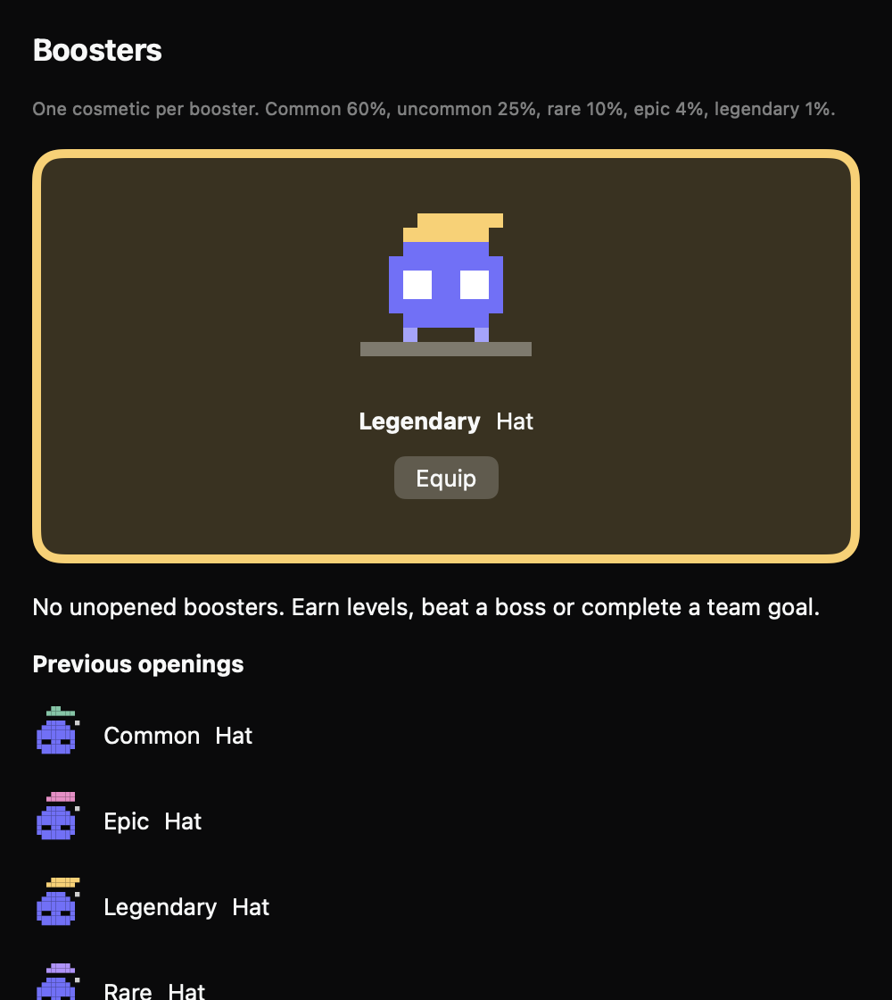
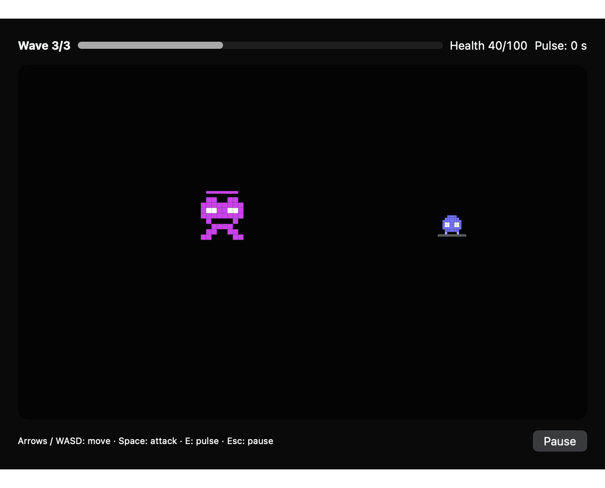
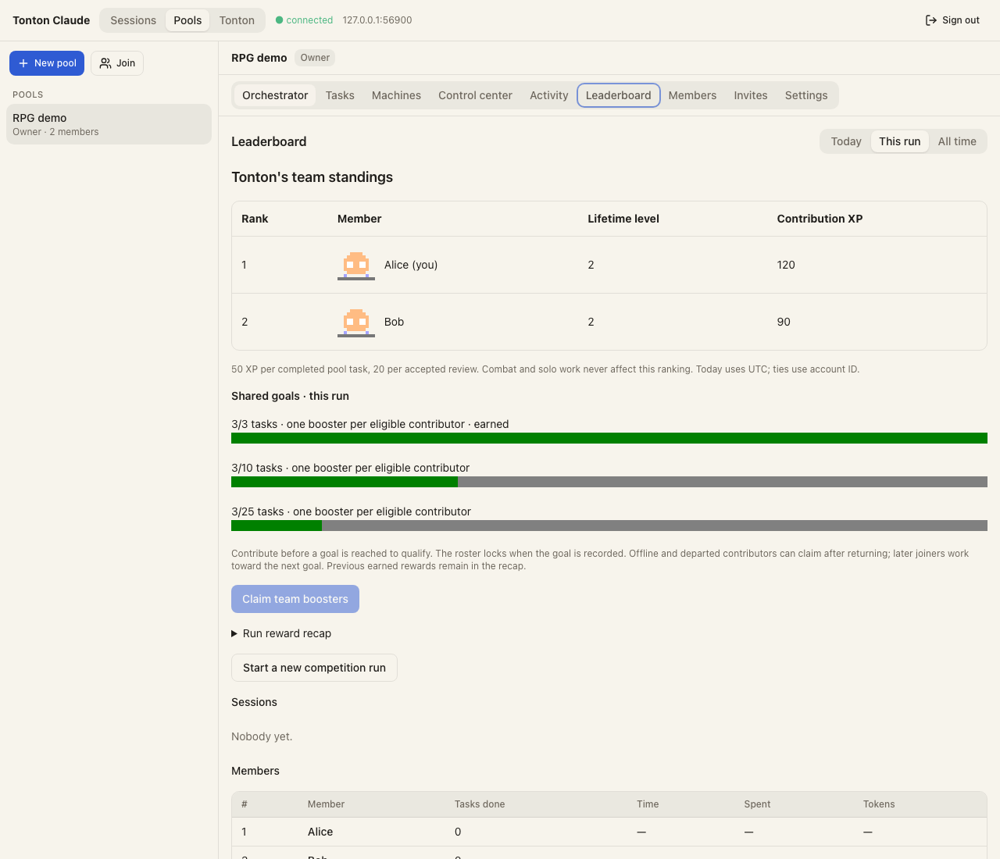

# Tonton's progression (rules version 1)

One account has one Tonton. Every machine contributes to it. A hackathon never resets the hero. Work rewards apply
equally to Claude Code and OpenCode. Cosmetics change appearance; combat upgrades change combat statistics.

## Rewards

| Source | XP | Sparks | Identity and limit |
| --- | ---: | ---: | --- |
| Completed checklist task | 10 | 1 | Session and normalized task text; once, even after reopening |
| Completed pool task | 50 | 5 | Pool and task id; once for the assignee at completion |
| Accepted review | 20 | 2 | Pool and task id; once for the reviewer at acceptance |
| Won combat encounter | 15 | 2 | Run and encounter id; once per encounter |
| Won boss fight | 75 | 10 | Run and boss id; once per boss |

These are tunable defaults, recorded with the rules version. Work rewards are capped at 1,000 XP per UTC day;
combat rewards at 300 XP. An award crossing the cap receives only the remaining XP and proportional sparks, rounded
down. Its receipt is still saved. Replaying it tomorrow earns nothing. Idle time, token spending, tool calls and
ordinary assistant messages earn nothing. Cancelled or failed tasks earn nothing. A completed checklist item is
self-reported work, not proof that tests pass. Pool tasks are the larger unit of work; a pool session's checklist
does not also earn solo XP.

Solo rewards begin with successful checklist results observed by the updated agent. Loading an old transcript or
OpenCode history does not backfill XP. Pending rewards already saved by the agent do survive restarts. Local-only
sessions shown by the Mac without an agent do not produce rewards. Pool completions store their original assignee,
reviewer and completion time in the sealed task, so a later reassignment cannot move an existing reward.

Level 1 starts at zero XP. Reaching level L needs 50 × L × (L − 1) lifetime XP: level 2 needs 100, level 3 needs 300,
level 4 needs 600. The maximum level is 100; XP can continue accumulating. Each new level grants one unopened
booster, identified by that level. The first completed task earns 10 XP and one spark. Ten such tasks reach level 2
and grant one booster. Six pool tasks earn 300 XP, level 3 and two boosters. A fight and a boss earn 90 XP and 12
sparks before the daily combat cap. Sparks buy permanent upgrades: the next rank costs 10 × (current rank + 1),
up to ten ranks each in health, attack and movement. The combat implementation owns the resulting stat multipliers.

## Cosmetics and boosters

Slots are skin, hat, accessory, aura and trail. One owned item per slot may be equipped; an absent or unknown asset
renders the base character without deleting ownership. All poses use the same anchors. Rarity is also shown as text.
The starter catalog has one item of each rarity in each slot. A free base skin is always available. To make progress
visible before booster opening ships, levels 2–6 also unlock one starter item per slot, once each.

Earned boosters contain one cosmetic. Version 1 odds are common 60%, uncommon 25%, rare 10%, epic 4%, legendary 1%.
Choose uniformly among items of the selected rarity. A duplicate becomes 1, 3, 8, 20 or 50 sparks respectively. No
purchase flow, paid currency or pity counter exists in version 1. The opening implementation must commit the draw,
consumption and reward together before playing its animation. Cancelling an animation never rerolls an item.

## Persistence and trust

The relay stores one opaque encrypted document per account, with an increasing revision. Clients read, decrypt,
apply an operation, encrypt, and compare-and-swap the revision. Conflicts re-read and reapply the same operation.
Receipts, boosters, inventory, loadout and balances are in that same transaction. Receipts are retained independently
of bounded pool/session history; reaching the receipt cap stops new rewards rather than silently forgetting claims.
Unknown schema versions and undecryptable documents fail closed, never overwrite with an empty hero.

Pending agent awards are sealed on disk and retried after reconnect/restart. A timeout after commit is safe to retry.
Clients show only committed balances. A new device reads the same document; account changes use a separate cache.
The Mac refreshes the committed hero every three seconds and disables equipment changes while syncing. Equipment
changes require a connection and report failures rather than claiming an item was equipped offline.
Old relays return 404 and leave RPG unavailable while sessions continue working. Upgrading the relay enables RPG.
Account-key regeneration deletes the unreadable old hero along with revoking machines; pool key rotation does not
affect the private hero. Pool-shared scores and profiles must use the pool key, never publish the private inventory.

The relay checks authentication, size and revisions, not XP. An account owner with a modified client can forge their
own progression. This is a friendly game, not a server-verified economy. Pool competition must derive contribution
scores from pool work receipts, excluding combat and solo work; it must not expose those private activities.

## Play, open and upgrade

On Mac, open Tonton's panel and choose **Boosters**, **Hero** or **Team**. The website has a **Tonton** tab for the
same inventory, openings and upgrades, and pool leaderboards show contribution XP and shared goals.

Loot table 1 uses the probabilities above and uniformly selects a slot within the chosen rarity. Browser draws use
WebCrypto; Mac draws use the system random generator. The two random values are selected before the transaction,
so CAS retries do not draw again. An opening receipt records the item, duplicate sparks and `tableVersion: 1`.
An older receipt without that optional field means table 1. The booster id identifies its source: `level-N`,
`boss-v1-<receipt>`, `achievement-v1-<achievement>`, or `team-v1-<pool>-<run start>-<target>`.
Unknown items and invalid tables fail before consuming anything. Previous openings can always be reopened in the UI.
The animation starts only after commit; skipping, closing or losing a response cannot change that outcome.
Reveals use rarity text, color, border weight and a short particle burst on Mac. Reduce Motion reveals immediately.
Neither client plays audio, so sound, quiet hours and Focus settings are never bypassed by an opening.

Health starts at 100 and gains 15 per rank. Attack starts at 15 and gains 3. Movement starts at 120 arena units per
second and gains 6. Each has ten ranks at the costs above. Purchases use the target rank, so retrying rank 1 after a
lost response cannot buy rank 2. Stats are frozen when a run starts; new upgrades affect the next run. Cosmetics
never change stats.

The native Mac arena is 640 × 400 units. Arrows or WASD move, Space attacks the nearest enemy within 68 units,
E pulses all enemies within 130 units, and Escape pauses. The pulse has a five-second cooldown; the attack has a
0.4-second cooldown. Controls are local to the arena's window. It cannot send prompts, approve permissions, spend
agent budgets or stop a coding session. Tab navigation and ordinary buttons handle opening, claiming and purchases.

A run has three chasers, then four mixed chasers/chargers, then a boss. Chasers deal contact damage; chargers mark
where they will dash; the boss marks a larger impact area and attacks faster below half health. Shapes, outlines and
an exclamation mark preserve cues without color or sound. Clearing a wave heals 20, up to maximum health. Defeat
pays nothing and can be restarted. Victory pays two encounter receipts and one boss receipt: up to 105 XP and 14
sparks, subject to the daily combat cap. A boss with positive awarded XP also grants one booster; capped bosses
cannot mint boosters endlessly. The maximum is four rewarded bosses per UTC day, fewer after encounter XP.
A fresh run has a new UUID; replaying a saved result keeps its original UUID and UTC start date.

The simulation uses fixed 1/60-second steps and bounds catch-up to 0.25 seconds. Losing keyboard focus, minimizing
or closing pauses it and clears input. Paused play stops the simulation task and mascot timeline. An account-key-
encrypted local checkpoint is saved every second and at transitions. Restart restores it paused. Offline play may
finish one run; its won result is retained until a successful claim, before another run can start. A claim can be
retried on a lost response without duplicating rewards. Active runs stay on their originating Mac; permanent rewards,
upgrades and equipment sync to other clients. Account switching clears the in-memory run and uses a separate checkpoint.

## Competition and cooperation

`pool_rpg` is a separate CAS document per pool, capped at 4 MiB. It is sealed with the current pool key, using the
existing key-version envelope. It retains first-completion attribution, public hero profiles, and locked goal rosters.
It contains no private inventory, solo tasks, combat receipts, task descriptions or prompts. Every HTTP request checks
current membership; viewers may read but not publish. A removed member cannot read it through the relay. Keyrings
retain older keys to open an earlier ledger and reseal the next update with the new key.

Updated agents archive completion receipts encrypted on disk before publishing, independently of bounded pool events.
The Mac Team tab and web leaderboard also reconcile current task snapshots. This preserves contributions after events
are pruned or tasks are deleted after being recorded. Work deleted before any updated client observes it cannot be
reconstructed. Completions made by older agents without completion attribution are not guessed from events.
At 10,000 durable completions, 1,000 profiles or 1,000 goal receipts, new ledger writes fail closed.

Rank by 50 contribution XP per first completed task and 20 per accepted review. Combat and solo XP are excluded;
private daily XP caps do not change this contribution measure. Ties sort by account id, independent of locale.
Current members appear even at zero; previously recorded contributors remain when they leave. Their last published
level and equipped appearance are shown, separately from contribution score. Profiles refresh while the Team panel,
web leaderboard or an updated pooled agent is active. No raw private XP balance is published.

**Today** uses UTC, **This run** starts at the pool's durable `startedAt` (or creation date), and **All time** keeps
all receipts. An owner/admin explicitly starts a new competition run; simply pausing and resuming work does not reset
scores. This changes `startedAt`, so it also restarts the hackathon's elapsed-time baseline. It keeps permanent heroes,
completed tasks and earlier earned rewards. The existing session-level activity/spending table remains available.

Version 1 team goals are fixed at 3, 10 and 25 completed tasks; they cannot be edited mid-run. On first reaching a goal,
the ledger locks the accounts that authored or reviewed its first qualifying completions, sorted by completion time
then task id. Each eligible account can claim one booster. Late joiners qualify for later goals by contributing;
viewers who never contributed receive none. A contributor who was later demoted or departed retains eligibility and
can claim after returning. Offline members need not be present at the crossing. A replay or rejoin uses the same
booster identity. Starting a new run creates new goal identities; previous locked rosters remain in the recap.

Three RPG milestones extend the existing achievement catalog: **Team player** (ten work rewards), **Veteran Tonton**
(1,000 XP), and **Boss slayer** (one rewarded boss). Each grants one booster through the same inventory. Mac's existing
achievement tracker displays the badges; locked progress and claims are also shown in the hero panel and on the web.
Claiming again after opening does nothing because the opening receipt remains. Local legacy badges still use their
existing storage; the RPG milestone rewards are account-wide.

## Clients and isolated demo

| Client | Private inventory, opening, upgrades | Team standings and claims | Combat |
| --- | --- | --- | --- |
| Mac | Yes, English/French | Yes, plus link to pool page | Native arena and local resumable checkpoint |
| Website | Yes, with previews and reduced-motion reveals | Yes, with existing session drilldown | Play in the Mac app; rewards sync here |
| Windows/Linux island | Existing session UI; use the relay website for RPG | Relay website | Renderer not shipped |
| iPhone | Core can read the same hero; dedicated RPG screens not shipped | Relay website | Renderer not shipped |

Run `bun scripts/rpg-demo.ts`. It creates a relay on a random local port, two temporary accounts and isolated agent
reward collectors. Its printed local `demo.json` path contains recovery keys for Alice and Bob; paste them into two
separate disposable browser contexts. Nothing changes the real account, Claude settings, shell profile or login items.
Ctrl-C stops the demo and removes its temporary files. It uses normalized Claude/OpenCode work fixtures and a seeded
boss reward, not paid model calls. Play the native arena separately for the real combat simulation.

The repeatable automated version is `bun test test/rpg-loop.test.ts`; it checks both work sources, victory receipts,
concurrent opening, an upgrade, team eligibility, key rotation, membership revocation and restart. `RPGCombatTests`
drives the real simulation through defeat and through complete victories with base and upgraded heroes. TypeScript
and Swift both read the other's encrypted hero and contribution fixtures.

## Rollout

Update the relay first, then agents and the Mac app. The new REST routes are `GET`/`PUT /api/rpg` for accounts and
`GET`/`PUT /api/agent/rpg` for enrolled machines. A request has `{ rev, blob }`; a stale revision returns 409.
The document is capped at 4 MiB per account. The relay has no public progression endpoint.
This gameplay delivery adds one appended migration for `pool_rpg`, plus authenticated `GET`/`PUT
`/api/pools/:id/rpg` and `/api/agent/pools/:id/rpg`. Update the relay before the apps/agents to enable team progression.
The new pool document does not change the existing session WebSocket protocol. Private hero schema remains version 1;
old clients preserve balances and inventory and may omit opening table metadata, which defaults to table 1.

| Relay | Agent | Mac app | Behavior |
| --- | --- | --- | --- |
| Old | New | New | Sessions work; the panel asks for a relay update; agent rewards remain pending. |
| New | Old | New | Existing hero is readable; old agents do not earn XP. |
| New | New | Old | Agents earn and save XP; old apps keep their existing UI. |

No pool key or account key is exposed to the relay. Private hero data is independent of pool keys. The pool
leaderboard publishes only a separate pool-key-encrypted profile, never the account document.

## Visual checks

The wardrobe was rendered from its SwiftUI view at 380, 460 and 500 points, using sample ownership and the dark
palette. Native controls were captured in an offscreen NSHostingView because ImageRenderer does not render them.
The sprites were checked at 18, 36 and 72 points in each existing pose with motion disabled in the renderer.
These images do not verify live animation timing, hover, scrolling or the actual notch window.

The gameplay UI was checked with offscreen AppKit captures of all five rarity reveals, upgrades and arena states.
The harness sends real local key events to the arena responder and verifies movement. Browser checks use headless
Chromium against the isolated relay: sign-in, opening one booster, an upgrade, reload persistence, a 390 px viewport
and pool standings, with no console errors. The Mac renderer uses fixture stores, so it does not sign into the installed
app. These checks do not constitute human playtesting alongside live permission prompts, VoiceOver testing, or a
production frame-time/CPU profile. The simulation suite checks fixed-step movement and pause, and scripted players
complete both base and upgraded runs. No deployment or release is performed by the demo.

